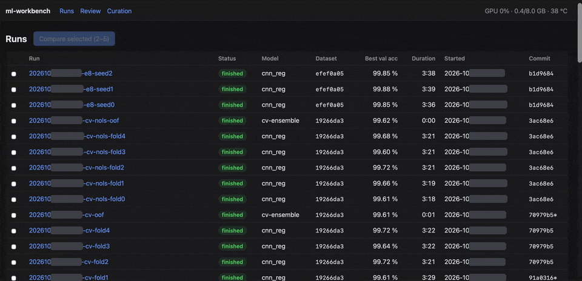

# ml-workbench

A small browser workbench for watching training runs live, browsing images,
inspecting errors and curating labels. Dataset-agnostic via a small adapter interface.

v1: runs, live run, compare. v2: evaluation, data explorer. v3: review queue and curation.

<p align="center"></p>

*Live training run, a click in the confusion matrix, relabelling in the review queue with the
keyboard (MNIST, from [mnist-showcase](https://github.com/alb-i/mnist-showcase)).*

## Start

```bash
# environment: see ../mnist-showcase/environment.yml (micromamba env `mnist-showcase`)
micromamba run -n mnist-showcase workbench          # defaults: $RUNS_DIR/mnist, $DATA_DIR/mnist from .env
micromamba run -n mnist-showcase workbench --runs /path/to/runs --data /path/to/data --port 8000 \
    --curation /path/to/curation --reviewer immo   # default: ../mnist-showcase/curation
# from the Mac: ssh with LocalForward 8000 127.0.0.1:8000, then open http://localhost:8000
```

The server binds to 127.0.0.1 only and runs on the CPU.

## Pages

| Page     | URL                     | Content                                                          |
|----------|-------------------------|------------------------------------------------------------------|
| Runs     | `/`                     | All runs: status, model, dataset version, best val acc, duration, commit; refreshes every 5 s; select 2–5 to compare |
| Live run | `/runs/<run-id>`        | Loss, accuracy, learning rate, throughput, GPU memory/utilisation/temperature; live via SSE |
| Compare  | `/compare?ids=a&ids=b`  | Overlaid curves of 2–5 runs, config diff side by side            |
| Evaluation | `/runs/<run-id>/evaluation?split=test` | Accuracy, macro-F1, ECE; confusion matrix (click a cell → its images), per-class precision/recall/F1, reliability diagram |
| Data     | `/runs/<run-id>/data?split=test` | Grid of samples with label/prediction/confidence/loss; filter by label, prediction, errors, loss, confidence; sort by loss, confidence, probability of the label |
| Sample   | `/runs/<run-id>/data/<sample-id>` | Large image, label in the run and in the dataset, prediction, top-3 probabilities, curation decisions |
| Review   | `/review?run=<run-id>&split=train` | Candidates of a run's `label_issues.parquet` in rank order, undecided ones only (or `unsure=true` for a second look); keys 0–9 relabel (the given label's digit = keep), k keep, d drop, u unsure, n next, r reason; progress bar |
| Curation | `/curation` | All decisions (filter by action and round), undo, agreement with the model, "Export to decisions.csv" |

Images: `/images/<sample-id>.png?scale=3` from the dataset adapter (`workbench.datasets`;
MNIST reads `<data>/raw/*.gz`). Without `--data` the pages show no images.

JSON: `/api/runs`, `/api/runs/<run-id>/metrics`, `/api/runs/<run-id>/stream` (SSE), `/api/gpu`.

## Run folder format

The workbench only reads run folders; the training code writes them.

```
<runs>/<run-id>/
  meta.json        # run_id, git_commit, dataset_version, start_time, host,
                   # status (running | finished | crashed), end_time
  config.yaml      # complete resolved config
  heartbeat        # touched every 10 s while running
  metrics.jsonl    # one JSON object per line: step, epoch, split (train|val), loss, acc,
                   # lr, img_s, gpu_mem_gb, weight_delta_<lag>, ts (unix seconds)
                   # weight_delta_<lag> = sum |w - w_lag_steps_ago| over all parameters;
                   # any number of lags, each charted as its own line
  checkpoints/
  predictions/<split>.parquet   # id, label, pred, p0..p<K-1>, loss (any split names)
  samples/*.png    # optional images shown on the live page (e.g. an augmented batch)
```

Status: `finished`/`crashed` as recorded in meta.json; a run that still says `running` but whose
heartbeat is older than 30 s (killed process) is shown as `crashed`.

## Curation folder

The only place the workbench writes. `decisions.sqlite` holds every decision (with the given
label, the model prediction and the source run); an empty database imports an existing
`decisions.csv`. Export overwrites `decisions.csv` (columns sample_id, action, new_label, reason,
reviewer, timestamp, round; one row per decision, oldest first, a later row for a sample wins),
which is then committed in the dataset's repository.

## Tests

```bash
micromamba run -n mnist-showcase pytest -q
```

## Licence

MIT, see [LICENSE](LICENSE).
